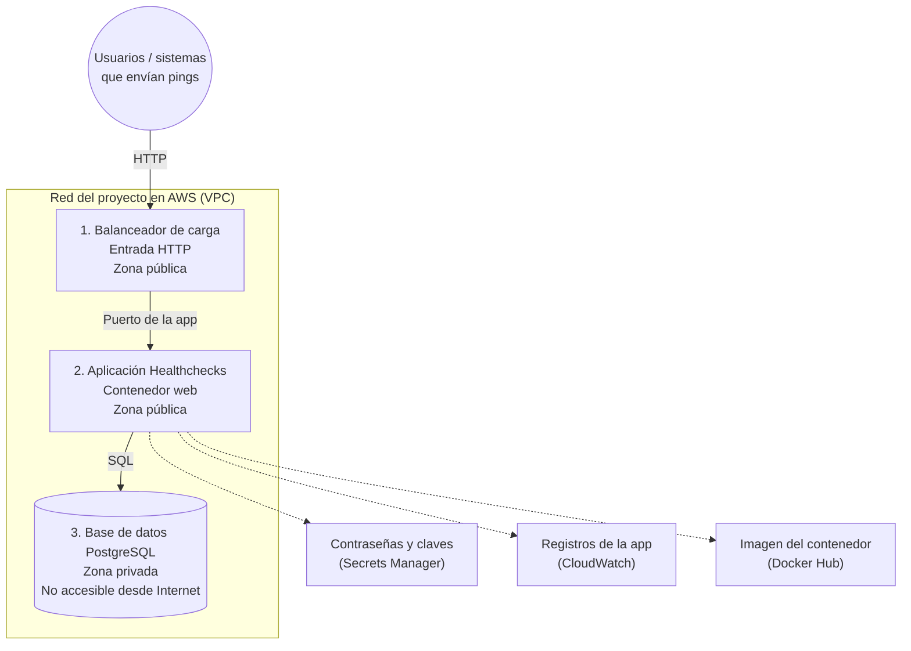

# Diseño de la Infraestructura

Este apartado describe cómo se despliega Healthchecks en la nube (AWS) mediante
Terraform. La idea central es simple: **pasar el esquema de Docker Compose
(`web` + `db`) a una infraestructura en la que la aplicación y la base de datos
quedan claramente separadas**.

En el modo de cómputo activo (**contenedores gestionados en AWS**,
tipo Fargate).

## De Docker Compose a la nube (mapa rápido)

Antes de entrar en detalle, conviene ver la equivalencia con lo que el equipo
ya conoce del proyecto:

| En Docker Compose | En AWS | Uso |
|---|---|---|
| Puerto `8000` expuesto | Balanceador de carga (entrada HTTP) | Punto de entrada único y controlado |
| Contenedor `web` (aplicación) | Servicio de contenedores (ECS) | Ejecuta Healthchecks (uWSGI + alertas) |
| Contenedor `db` (PostgreSQL) | Base de datos gestionada (RDS) | Guarda checks, pings, usuarios, etc. |
| Volumen `db-data` | Disco de la base de datos | Los datos no se pierden si reinicia la app |
| Variables / secretos del `.env` | Secrets Manager + variables de entorno | Contraseñas fuera del código |

Internet llega al balanceador; el balanceador habla con la
aplicación; la aplicación habla con la base de datos.

---

## 1 Diagrama de la infraestructura



### Qué hay en cada parte

#### 1) Redes

La infraestructura define una red propia del proyecto dividida en dos zonas:

| Zona | Qué hay | Quién puede entrar |
|---|---|---|
| **Pública** | Balanceador y aplicación | Tráfico HTTP permitido (restringido a IPs autorizadas) |
| **Privada** | Solo la base de datos | Únicamente la aplicación; **no** Internet |

Además hay dos zonas de disponibilidad (por ejemplo, dos centros dentro de la
misma región). Eso lo exige el balanceador y la base gestionada pues es un requisito del servicio en la nube.

**Cadena de acceso (seguridad por capas):**

```text
Internet  →  Balanceador  →  Aplicación  →  Base de datos
```

Nadie desde fuera puede conectarse directo a PostgreSQL.

#### 2) Aplicación

| Elemento | Decisión del proyecto | Justificación |
|---|---|---|
| Cómo corre | Un contenedor de la app | Equivale al servicio `web` de Compose |
| Tamaño | Media CPU y 1 GB de memoria | Suficiente para uWSGI y los procesos de alertas |
| Cantidad | **Una** instancia de la app | Evita duplicar migraciones y daemons de alertas |
| Entrada | Balanceador delante | Sustituye el `ports: "8000:8000"` de Compose |

Dentro del contenedor sigue corriendo lo mismo que en la vista de componentes:
la aplicación web y los procesos que detectan caídas y envían alertas.

#### 3) Persistencia

| Elemento | Decisión del proyecto | Justificación |
|---|---|---|
| Motor | PostgreSQL 16 | El mismo motor que en Compose |
| Tamaño de máquina | Instancia pequeña | Adecuada a la carga del proyecto académico |
| Disco | Almacenamiento dedicado y cifrado | Reemplaza el volumen `db-data` |
| Ubicación | Zona privada | La BD no queda expuesta a Internet |
| Copias de seguridad | Retención corta | Protege el estado sin subir demasiado el costo |

Las contraseñas de la base y la clave secreta de Django no van en el código:
se guardan en un servicio de secretos y la aplicación las lee al arrancar.

> Diagrama Graphviz (misma idea, más compacto): [`salida/infraestructura.gv`](salida/infraestructura.gv).

---

## 2 Justificación del dimensionamiento

El tamaño elegido no busca máxima potencia, busca demostrar el despliegue
completo del proyecto con un costo razonable y un comportamiento predecible.

| Decisión | ¿Por qué? |
|---|---|
| **Una sola copia de la aplicación** | En Healthchecks, cada contenedor arranca migraciones y procesos de alerta. Varias copias a la vez complicarían el comportamiento (trabajos duplicados). Con una instancia se mantiene el mismo modelo que Compose. |
| **Media CPU y 1 GB de RAM** | La app no es solo el sitio web: también corre procesos en segundo plano. Ese tamaño cubre el arranque y el uso normal del proyecto sin sobredimensionar. |
| **Menos procesos uWSGI que el default** | Con media CPU, conviene no abrir demasiados workers. Se prioriza estabilidad frente a concurrencia alta. |
| **Base de datos pequeña** | El volumen de datos del proyecto (checks, pings, usuarios de demostración) no requiere una instancia grande. |
| **Disco con margen de crecimiento** | Se parte de un tamaño inicial razonable y se permite crecer un poco si los datos aumentan, sin rediseñar todo. |
| **Sin alta disponibilidad completa de la BD** | El objetivo de esta entrega es demostrar la arquitectura y el despliegue, no operar un servicio 24/7 con failover automático. Eso se puede plantear como mejora futura. |
| **Acceso HTTP restringido** | Solo IPs autorizadas llegan al balanceador. Es una medida práctica de seguridad para un entorno académico expuesto en Internet. |

En resumen, el dimensionamiento es mínimo pero coherente con cómo funciona
Healthchecks (un `web` + un `db`), no un intento de diseño de producción a gran
escala.

---

## 3 Separación de capas: cómputo vs. persistencia

La capa de cómputo es  donde se ejecuta el programa (contenedor de Healthchecks).

La capa de persistencia es donde se guardan los datos (PostgreSQL).

En Compose ya eran dos servicios distintos, pero compartían la misma máquina
Docker y una red “plana”. En la nube esa separación se hace explícita.

Se separan porque los datos no dependen del ciclo de vida de la app. Si se reinicia, actualiza o reemplaza el contenedor web, la base de datos sigue intacta. Eso evita el error de guardar datos dentro del mismo contenedor de la aplicación.

La base queda en zona privada y solo acepta conexiones desde la aplicación.
Internet no tiene ruta directa hacia PostgreSQL.

También es importante tener en cuenta las responsabilidad de cada una:
- La capa de cómputo se escala o redespliega cuando cambia la app.  
- La capa de persistencia se respalda y se cuida como almacén de estado.  
Cada una puede evolucionar sin arrastrar a la otra de forma innecesaria.

Finalmente, la aplicación consume la contraseña; no la lleva escrita en el repositorio.
Eso refuerza la frontera entre código en ejecución y datos sensibles.

Esta separación encaja con la vista de componentes del software
([`vista_cc.md`](vista_cc.md)): el monolito Django sigue siendo un solo
componente de aplicación, pero su **estado** vive fuera, en un servicio de
datos dedicado. También conecta con el análisis de puntos únicos de falla
([`spofs.md`](spofs.md)): al externalizar la BD se aclara cuál es el componente
crítico de persistencia y cómo protegerlo.
