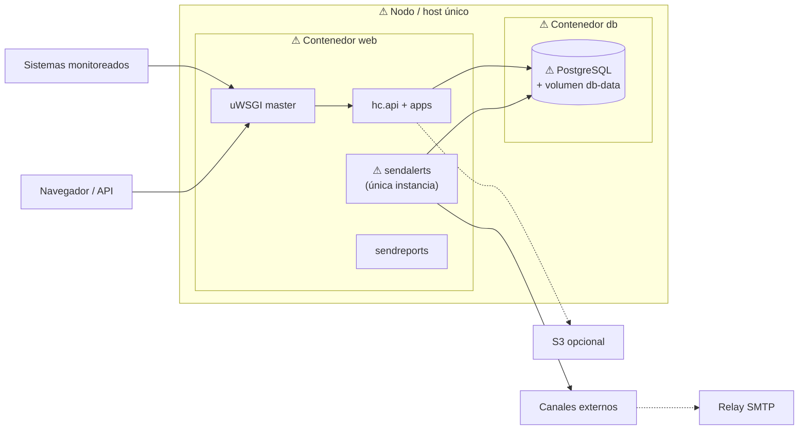

# Identificación de puntos únicos de falla (SPOFs)

Análisis sobre la arquitectura de despliegue documentada en
[`vista_cc.md`](vista_cc.md) (`docker-compose`: un servicio `web` + un servicio
`db`). Un **SPOF** es un componente cuya falla detiene o degrada de forma crítica
una función esencial **sin que exista otra instancia o camino alterno** en la
configuración actual.

## 1. Alcance funcional esencial

Para Healthchecks se consideran esenciales:

1. **Recibir pings** (HTTP y, si está habilitado, SMTP).
2. **Persistir el estado** de checks / pings / flips.
3. **Detectar caídas** y **enviar alertas** a los canales configurados.
4. **Exponer dashboard/API** para operar el sistema.

## 2. Mapa de SPOFs sobre la vista C&C

## 3. Inventario de SPOFs

| ID | Componente | Severidad | Función afectada si falla | ¿Por qué es SPOF? | Evidencia |
|---|---|---|---|---|---|
| **S1** | **PostgreSQL (`db`)** | Crítica | Todo: pings, UI, API, alertas | Una sola instancia; sin réplica ni failover en compose | `docker-compose.yml` → servicio `db` único |
| **S2** | **Volumen `db-data`** | Crítica | Pérdida o indisponibilidad del estado | Único almacén persistente del dominio; sin backup/réplica declarados en el compose | `volumes: db-data` |
| **S3** | **Contenedor `web` / uWSGI** | Crítica | Ingesta HTTP, dashboard, API y daemons | Un solo servicio `web`; los workers (4) mitigan fallas de *request*, no la caída del contenedor o del master | `docker-compose.yml` + `uwsgi.ini` |
| **S4** | **`sendalerts` (daemon)** | Crítica (misión) | Detección de caídas y envío de alertas | Una sola instancia `attach-daemon`; si el proceso o el contenedor mueren, no hay otro consumidor de la “cola” basada en tablas | `uwsgi.ini` línea `attach-daemon … sendalerts` |
| **S5** | **Host / nodo de despliegue** | Crítica (infra) | Disponibilidad global | `web` y `db` suelen vivir en la misma máquina en el compose de laboratorio | Topología de un solo compose |
| **S6** | **`smtpd` (si se usa ping por correo)** | Alta *condicional* | Solo el camino de ping SMTP | Un único daemon opcional; no hay balanceo SMTP alterno en el compose | `if-env = SMTPD_PORT` + `attach-daemon smtpd` |
| **S7** | **Proveedor de un canal de notificación** | Media *por canal* | Alertas por ese canal | Cada integración externa es un SPOF *del canal*, no del núcleo; se mitiga con varios canales por proyecto | `TRANSPORTS` / `hc.integrations.*` |
| **S8** | **Relay SMTP saliente (`EMAIL_HOST`)** | Media *condicional* | Correo de verificación, reportes y canal email | Un solo host SMTP configurado típico | `settings.py` → `EMAIL_HOST*` |
| **S9** | **Object storage S3/MinIO** | Baja–media *condicional* | Lectura/escritura de bodies grandes | Opcional; el ping y la alerta siguen si el body cabe en BD o no se requiere el payload | `S3_*`, `hc/lib/s3.py` |

## 4. Detalle de los SPOFs críticos

### S1 — PostgreSQL

- **Impacto:** sin BD no hay escritura de pings, ni lectura de dashboard, ni polling de `sendalerts`.
- **Acoplamiento:** apps Django, `sendalerts`, `sendreports` y `smtpd` dependen del mismo almacén.
- **Mitigación típica (fuera del compose actual):** réplica primaria/standby, HA (Patroni/Cloud managed), backups + PITR, healthchecks con failover.

### S2 — Volumen `db-data`

- **Impacto:** corrupción o pérdida del volumen = pérdida del historial y de la configuración (checks, canales, usuarios).
- **Mitigación:** backups periódicos, snapshots, réplicas geográficas.

### S3 — Contenedor `web` / proceso uWSGI master

- **Impacto:** deja de escucharse `:8000`; caen UI, API y pings HTTP. Además caen los daemons acoplados.
- **No es SPOF a nivel worker:** `processes = 4` permite sobrevivir a la muerte de un worker individual (`harakiri = 10`).
- **Sí es SPOF a nivel instancia:** no hay segundo contenedor ni balanceador en el compose.
- **Mitigación:** varias réplicas detrás de un load balancer; separar daemons del proceso web.

### S4 — `sendalerts`

- **Impacto:** los pings pueden seguir llegando y guardándose, pero **no se detectan timeouts ni se notifican** caídas → falla la promesa central del producto.
- **Por qué es único:** un solo proceso hace poll de `Check`/`Flip`; no hay cola externa con múltiples consumidores.
- **Mitigación parcial ya existente:** uWSGI reinicia el daemon si muere (`attach-daemon`), pero eso no cubre caída del contenedor ni partición prolongada.
- **Mitigación fuerte:** ejecutar `sendalerts` en N réplicas con exclusión mutua/locking en BD, o mover el trabajo a una cola con varios workers.

### S5 — Host único

- **Impacto:** falla de máquina, disco o red del host tumba `web` + `db` a la vez.
- **Mitigación:** despliegue multi-AZ / multi-nodo.

## 5. Qué *no* es SPOF (o lo es solo de forma débil)

| Elemento | Motivo |
|---|---|
| Worker uWSGI individual | Hay 4 procesos; el master puede respawnear |
| App Django concreta (`front`, `payments`, …) | Módulos del mismo proceso; la falla suele ser de bug local, no de topología |
| `sendreports` | Afecta reportes/recordatorios, no la detección inmediata de caídas |
| Un canal de notificación entre varios | Si el proyecto tiene Slack + email + PagerDuty, la falla de uno no silencia todas las alertas |
| S3 ausente o caído | El núcleo opera sin object storage; solo se degrada el manejo de payloads grandes |

## 6. Resumen ejecutivo

En el despliegue de referencia, los SPOFs **estructurales** son:

1. **PostgreSQL + su volumen** (estado).
2. **La única instancia `web`/uWSGI** (borde + daemons).
3. **`sendalerts` como único detector/notificador**.
4. **El host único** que concentra esos servicios.

Los demás (SMTP in/out, S3, un proveedor de chat) son SPOFs **de camino o de canal**, relevantes según cómo se use el sistema.

Esta identificación alimenta el análisis de disponibilidad y las tácticas de tolerancia a fallos (redundancia, desacoplar daemons, multi-canal, backups).
