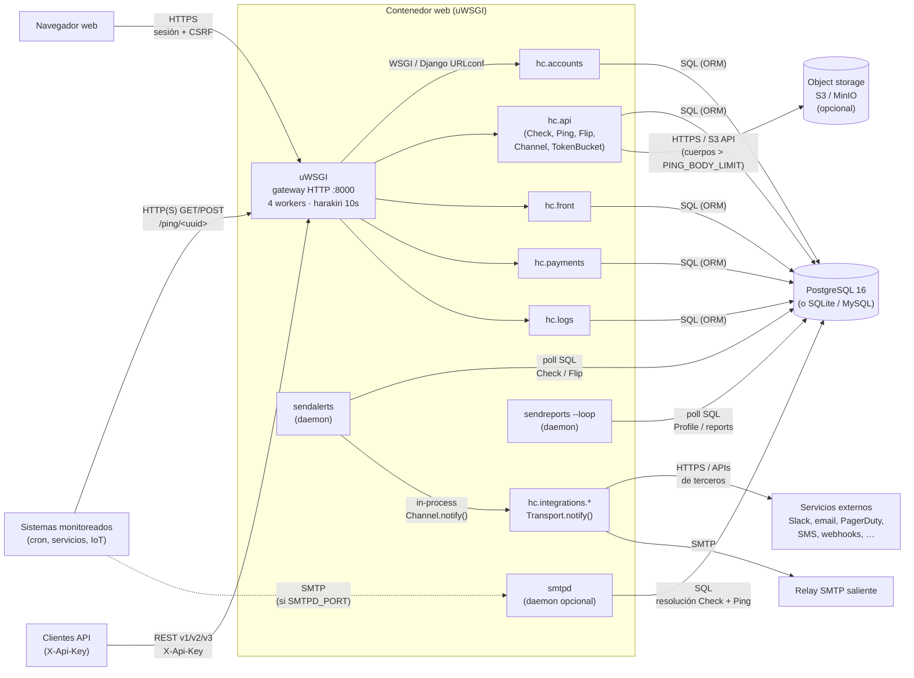

# Diseño Arquitectural — Vista de Componentes y Conectores (C&C)

Este documento describe la **vista C&C** del proyecto Healthchecks a partir del código y la
configuración de despliegue reales.

## 1 Estilo y alcance

Healthchecks se despliega como un **monolito Django** supervisado por **uWSGI**,
con procesos en segundo plano acoplados al mismo contenedor (`attach-daemon`) y
una base de datos relacional. No hay broker de mensajería ni microservicios
independientes en el `docker-compose` del proyecto.

**Fuentes verificadas:**
- `docker/docker-compose.yml` — servicios `web` + `db` (PostgreSQL 16)
- `docker/uwsgi.ini` — HTTP `:8000`, workers, daemons
- `docker/Dockerfile` — imagen de aplicación
- `hc/settings.py`, `hc/urls.py`, `hc/api/models.py`
- `hc/api/management/commands/{sendalerts,sendreports,smtpd,prune*}.py`
- `hc/integrations/*/transport.py`

## 2 Diagrama C&C



> Archivo Graphviz equivalente: [`salida/vista_cc.gv`](salida/vista_cc.gv).

## 3 Componentes

| Componente | Tipo C&C | Responsabilidad | Evidencia |
|---|---|---|---|
| **Sistemas monitoreados** | Actor | Envían *pings* de vida (HTTP o correo) | `/ping/<uuid>`, `PING_EMAIL_DOMAIN` |
| **Navegador** | Actor | Login, dashboard, gestión de proyectos/canales | `hc.front`, `hc.accounts` |
| **Clientes API** | Actor | Automatización vía API REST | `hc/api/urls.py` (`api/v1\|v2\|v3`) |
| **uWSGI** | Gateway / process host | Recibe HTTP, sirve estáticos, ejecuta WSGI, supervisa daemons | `docker/uwsgi.ini` |
| **hc.accounts** | Componente de servicio | Auth, proyectos, equipos, WebAuthn | `INSTALLED_APPS`, `hc/accounts` |
| **hc.api** | Componente de servicio (núcleo) | Dominio: Check, Ping, Flip, Channel, notificaciones, rate limit | `hc/api/models.py` |
| **hc.front** | Componente de servicio | UI web / dashboard | `hc/front` |
| **hc.payments** | Componente de servicio | Suscripciones (feature flag) | `hc/payments` |
| **hc.logs** | Componente de servicio | Persistencia de logs de aplicación en BD | `hc.logs.Handler` en `LOGGING` |
| **hc.integrations.\*** | Componente de servicio (plugins) | Canales de notificación con interfaz `Transport` | `TRANSPORTS` + `*/transport.py` |
| **sendalerts** | Componente reactivo | Detecta caídas, crea Flip, despacha notificaciones en paralelo | `attach-daemon` + `ThreadPoolExecutor` |
| **sendreports** | Componente reactivo | Reportes periódicos y recordatorios | `attach-daemon … sendreports --loop` |
| **smtpd** | Componente reactivo (opcional) | Traduce ping por correo a evento de dominio | `if-env = SMTPD_PORT` |
| **Maintenance jobs** | Batch (cron externo) | Poda de datos/objetos (`pruneobjects`, `prunetokenbucket`, …) | management commands (no van en `attach-daemon`) |
| **PostgreSQL** | Almacén | Persistencia principal en despliegue Docker | `docker-compose.yml` servicio `db` |
| **S3 / MinIO** | Almacén (opcional) | Cuerpos de ping grandes | `S3_*` en `settings.py`, `hc/lib/s3.py` |
| **Servicios externos** | Externos | Destinos de alerta (chat, incidentes, SMS, …) | transports de integración |
| **Relay SMTP** | Externo | Correo saliente (verificación, reportes, canal email) | `EMAIL_HOST*` |

### Clasificación útil para el laboratorio

- **Componentes arquitectónicos (infraestructura / borde):** uWSGI, PostgreSQL, S3/MinIO, smtpd (adaptador de protocolo), servicios externos.
- **Componentes de servicio (dominio / aplicación):** `accounts`, `api`, `front`, `payments`, `logs`, `integrations.*`, `sendalerts`, `sendreports`.
- **Actores:** sistemas monitoreados, navegador, clientes API.

> Nota: las apps Django **no** son microservicios desplegados por separado; comparten proceso WSGI y base de datos. En C&C se modelan como componentes lógicos del monolito.

## 4 Conectores y protocolos

| Conector | Origen → Destino | Protocolo / mecanismo | Qué transporta |
|---|---|---|---|
| Ping HTTP | Sistemas → uWSGI | **HTTP(S)** GET/POST/HEAD | Señal de vida (`/ping/<uuid>`) |
| Ping SMTP | Sistemas → smtpd | **SMTP** | Correo a `<uuid>@PING_EMAIL_DOMAIN` |
| UI | Navegador → uWSGI | **HTTPS** + sesión Django / CSRF | Interacción humana |
| API | Clientes → uWSGI | **REST** + header `X-Api-Key` | CRUD de checks/canales, etc. |
| Enrutamiento | uWSGI → apps Django | **WSGI** + URLconf | Request/response HTTP |
| Persistencia | Apps / daemons → PostgreSQL | **SQL** vía ORM Django | Estado de dominio |
| Poll de alertas | sendalerts → PostgreSQL | **SQL polling** (sin broker) | Checks vencidos / Flips pendientes |
| Poll de reportes | sendreports → PostgreSQL | **SQL polling** | Perfiles a notificar |
| Overflow de body | hc.api → S3/MinIO | **HTTPS / S3 API** (minio-py) | Cuerpos > `PING_BODY_LIMIT` |
| Despacho interno | sendalerts → integrations | **Llamada in-process** (`Channel.notify`) | Evento Flip → canal |
| Notificación | integrations → externos | **HTTPS** (mayoría) / **SMTP** (email) / APIs propietarias | Alerta al operador |
| Supervisión de procesos | uWSGI → daemons | **attach-daemon** (uWSGI) | Ciclo de vida de sendalerts/sendreports/smtpd |

### Flujos principales

1. **Ingesta de ping:** actor → uWSGI → `hc.api` → PostgreSQL (+ S3 si el body es grande).
2. **Detección de caída:** `sendalerts` sondea PostgreSQL → crea/procesa `Flip` → `Channel.notify()` → transport → servicio externo.
3. **Ping por correo (opcional):** SMTP → `smtpd` → resuelve Check → escribe Ping en PostgreSQL.
4. **Operación humana:** navegador → uWSGI → `front` / `accounts` → PostgreSQL.

## 5 Configuración de despliegue (contexto C&C)

```text
docker-compose
├── db   : postgres:16
└── web  : imagen Healthchecks
           └── uwsgi (http-socket :8000)
               ├── hc.wsgi:application   (apps Django)
               ├── attach-daemon sendalerts
               ├── attach-daemon sendreports --loop
               └── attach-daemon smtpd     [solo si SMTPD_PORT]
```

No hay Redis, cola RabbitMQ/Kafka ni servicios de notificación internos en el compose
actual. La “cola” de alertas es **basada en tablas** (`Check` / `Flip`).

